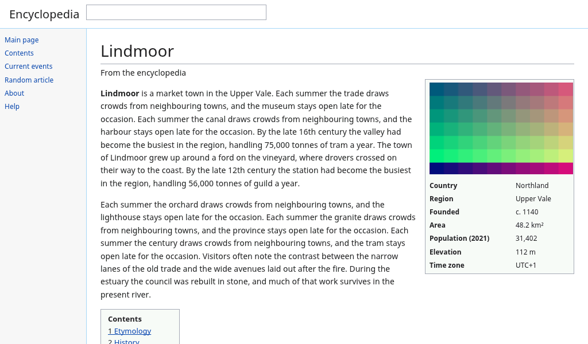
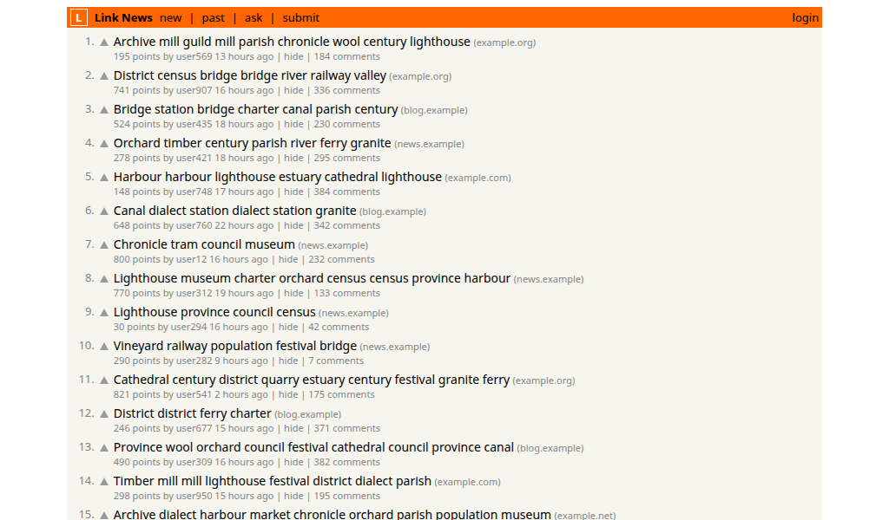

# M1 side-by-side: engine vs Chromium

For the owner's review (roadmap node `eng-m1-side-by-side-review`). After sign-off, the goldens are frozen for regression.

- **Engine:** `testpages/golden/<page>.png` is what `cargo test` checks. It is the core API at 1024x600, rendered in 32px bands, RGB565 expanded to 8-bit for the PNG.
- **Reference:** `testpages/reference/<page>.png` is headless Chromium from the pinned Playwright image. Viewport 1024x600, scale 1, scrollbars hidden (`scripts/reference-screenshots.sh`).
  - **Fonts:** both sides use only the two committed Noto Sans TTFs (`crates/embedded-browser-assets/fonts`), so serif and monospace fall back to Noto Sans on both.
  - **JS:** it is not switched off in Chromium. `--blink-settings=scriptEnabled=false` makes `--screenshot` write nothing. Instead, the script refuses pages that contain scripts or event handlers; none of the corpus does.
- **Difference share:** pixels whose per-channel difference, converted to luma, is over 24 (8-bit), over the whole screen. "Within 1px" is the share left when each engine pixel may match any reference pixel up to 1px away, which separates glyph rasterization (antialiasing, hinting, gamma) from layout shifts.

| page | differing pixels | verdict (proposed) |
|---|---|---|
| dashboard | 1.9 % (0.8 % within 1px) | match, except one gradient angle |
| article | 13.7 % (8.2 % outside the infobox and search box) | layout differences: missing table caption, form control sizing |
| links | 4.0 % (2.2 % within 1px) | layout matches; text is rasterized slightly differently |

## dashboard

| engine | reference |
|---|---|
|  |  |

- Layout, text, toggles, radial-gradient bulbs, shadows, status list and chart match.
- The "on" cards' `linear-gradient(160deg, #fff8e1, #fff 60%)` runs diagonally from the top-left in our render. In Chromium it is nearly vertical, from the top. This looks like Blitz's gradient-angle handling.
- The remaining difference is on text edges: same font and positions, different glyph rasterization.

## article

| engine | reference |
|---|---|
|  |  |

- **Missing `<caption>`:** the infobox's caption ("Lindmoor") is not rendered, so the infobox starts about 27px higher. The infobox and search-box areas account for 5.5 of the 13.7 points.
- **Search box:** the `<input type="search">` has no placeholder text ("Search"). It is also about 314px wide instead of Chromium's ~190px: the `flex: 1` input sits inside a `<form>`, so it is not a flex item, and Chromium uses the default 20-character width.
- Body text wraps identically, line for line. Floats, links, the colour-grid PNG and the table rows match. The 8.2 % outside the infobox and search box is on text edges (glyph rasterization).

## links

| engine | reference |
|---|---|
|  |  |

- Header bar, numbering, vote arrows, titles, domains and subtext lines match position for position.
- The difference is on text edges, mostly the small grey text; about half of it disappears with a 1px tolerance, the rest is glyph rasterization (weight/gamma), not layout.

## Not covered by these screenshots
- Only the first screen of each page is compared; scrolling comes in a later slice (`eng-m1-scroll-strip-cache`).
- Fetched real pages (Wikipedia, HN) are not committed (corpus policy). `embedded-browser-sim --headless <url> --out x.png` renders them for ad-hoc checks.
