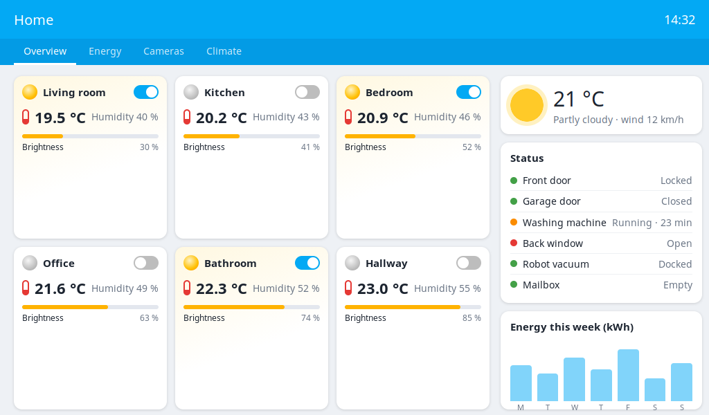
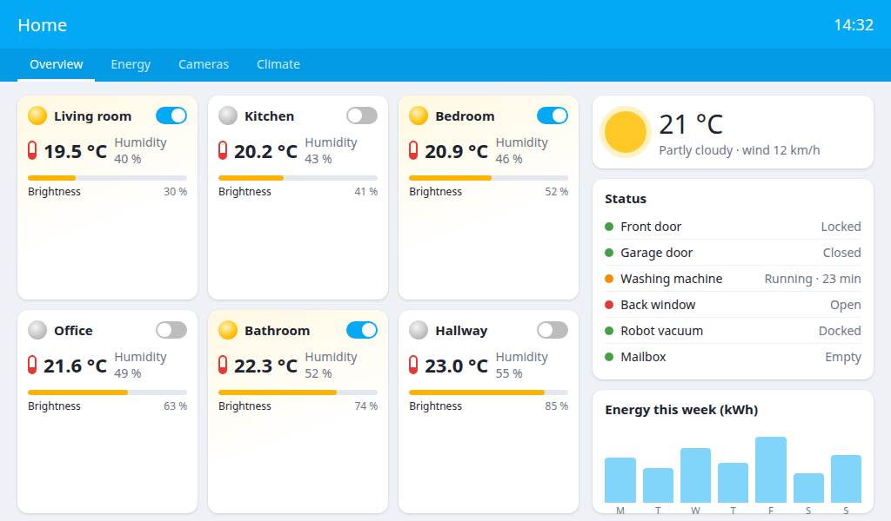
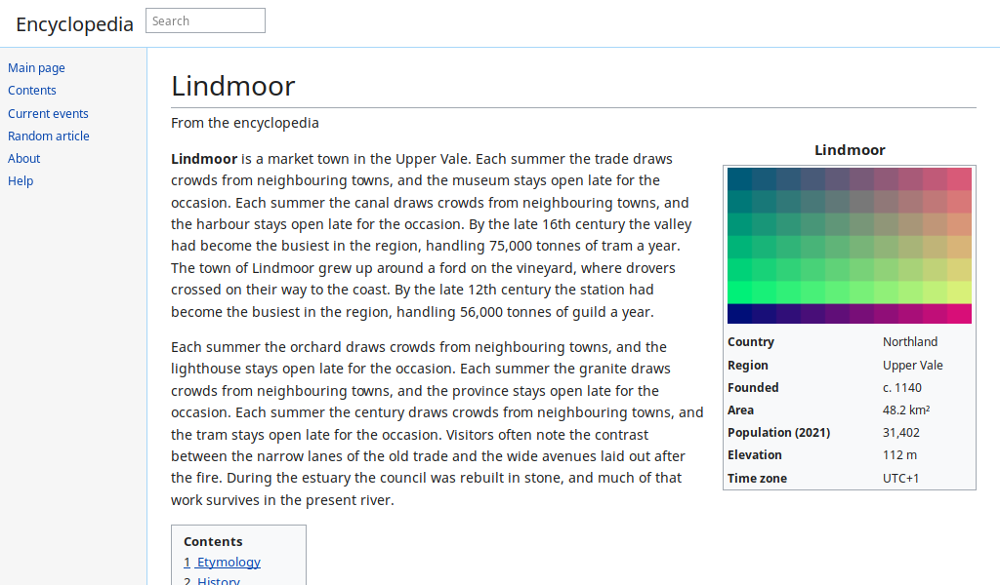
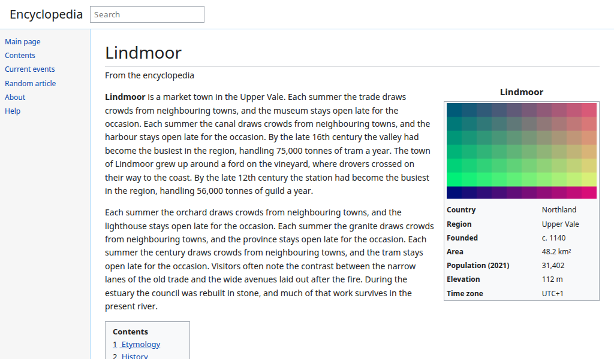

# M1 side-by-side: engine vs Servo vs Chromium

For the owner's review (roadmap node `eng-m1-side-by-side-review`). After sign-off, the goldens are frozen for regression.

- **Engine:** `testpages/golden/<page>.png` is what `cargo test` checks. It is the core API at 1024x600, rendered in 32px bands, RGB565 expanded to 8-bit for the PNG.
- **Reference:** `testpages/reference/<page>.png` is headless Chromium from the pinned Playwright image. Viewport 1024x600, scale 1, scrollbars hidden (`scripts/reference-screenshots.sh`).
  - **Fonts:** both sides use only the two committed Noto Sans TTFs (`crates/embedded-browser-assets/fonts`), so serif and monospace fall back to Noto Sans on both.
  - **JS:** it is not switched off in Chromium. `--blink-settings=scriptEnabled=false` makes `--screenshot` write nothing. Instead, the script refuses pages that contain scripts or event handlers; none of the corpus does.
- **Servo:** `testpages/reference-servo/<page>.png` is real Servo (servoshell 0.8.0-f10f711bc, the pinned v0.8.0-rc1 Linux x86_64 release build) run headless in Docker, 1024x600, same Noto-only fontconfig and no-scripts guard (`scripts/servo-screenshots.sh`). It is a second reference: our engine (Blitz) shares only html5ever and Stylo with Servo, so this answers "renders like Servo?". Servo and Chromium disagree with each other, so neither is ground truth.
- **Difference share:** pixels whose per-channel difference, converted to luma, is over 24 (8-bit), over the whole screen. "Within 1px" is the share left when each engine pixel may match any reference pixel up to 1px away, which separates glyph rasterization (antialiasing, hinting, gamma) from layout shifts.

Differing pixels, same method for every pair (the "within 1px" figure is in brackets; recomputed with a script, so it can differ by 0.1 from the older figures):

| page | ours vs Chromium | ours vs Servo | Servo vs Chromium | verdict (proposed) |
|---|---|---|---|---|
| dashboard | 1.9 % (0.9 %) | 10.6 % (6.6 %) | 11.0 % (7.0 %) | we match Chromium, except one gradient angle; Servo lays the grid out differently |
| article | 13.8 % (7.9 %) | 15.3 % (8.9 %) | 10.1 % (4.5 %) | Servo fixes our two gaps (caption, placeholder) but wraps text differently from both |
| links | 4.0 % (2.3 %) | 9.2 % (3.6 %) | 9.7 % (3.4 %) | layout matches in all three; Servo's text is slightly wider |

Our render is much closer to Chromium than to Servo on dashboard and links, and about as far from either on article. Servo is not closer to us than Chromium is.

## dashboard

| ours | Servo | Chromium |
|---|---|---|
|  |  |  |

- Layout, text, toggles, radial-gradient bulbs, shadows, status list and chart match.
- The "on" cards' `linear-gradient(160deg, #fff8e1, #fff 60%)` runs diagonally from the top-left in our render. In Chromium it is nearly vertical, from the top. This looks like Blitz's gradient-angle handling.
- The remaining difference against Chromium is on text edges: same font and positions, different glyph rasterization.
- **Servo renders the gradient correctly.** Sampled on the first "on" card, the top-left, top-right and middle colours are within 3 levels of Chromium's, a mostly vertical fade from the top. (Our RGB565 render fades somewhat faster toward the right edge, e.g. 255,255,247 vs 255,253,250 mid-card on the right.)
- **Servo gets the grid wrong, we get it right.** Servo's three card columns are about 14px wider and the right column about 42px narrower than in Chromium, and "Humidity 40 %" stays on one line instead of wrapping under its label. Our positions match Chromium.

## article

| ours | Servo | Chromium |
|---|---|---|
|  |  |  |

- **Missing `<caption>`:** the infobox's caption ("Lindmoor") is not rendered, so the infobox starts about 27px higher. The infobox and search-box areas account for 5.5 of the 13.7 points.
- **Search box:** the `<input type="search">` has no placeholder text ("Search"). It is also about 314px wide instead of Chromium's ~190px: the `flex: 1` input sits inside a `<form>`, so it is not a flex item, and Chromium uses the default 20-character width.
- **Servo, caption: correct.** The "Lindmoor" caption is rendered above the infobox, at Chromium's position (both within 1px).
- **Servo, search input: placeholder correct, width wrong.** The "Search" placeholder shows, as in Chromium. The box is about 123px wide: neither Chromium's ~190px nor our ~314px.
- **Servo text wraps differently from Chromium and from us.** Its glyph advances are about 1 % wider, so most paragraph lines break one word earlier (e.g. "had" moves to the next line); Chromium and our render wrap identically. That is why Servo scores no better than 10 % against either.
- Against Chromium, our body text wraps identically, line for line. Floats, links, the colour-grid PNG and the table rows match. The 8.2 % outside the infobox and search box is on text edges (glyph rasterization).

## links

| ours | Servo | Chromium |
|---|---|---|
|  |  |  |

- Header bar, numbering, vote arrows, titles, domains and subtext lines match position for position.
- Servo has the same layout, but its text is about 1.3 % wider (domain tags end about 14px later after long titles). Each of the three renderers rasterizes text differently.
- The difference against Chromium is on text edges, mostly the small grey text; about half of it disappears with a 1px tolerance, the rest is glyph rasterization (weight/gamma), not layout.

## Not covered by these screenshots
- Only the first screen of each page is compared; scrolling comes in a later slice (`eng-m1-scroll-strip-cache`).
- Fetched real pages (Wikipedia, HN) are not committed (corpus policy). `embedded-browser-sim --headless <url> --out x.png` renders them for ad-hoc checks.
