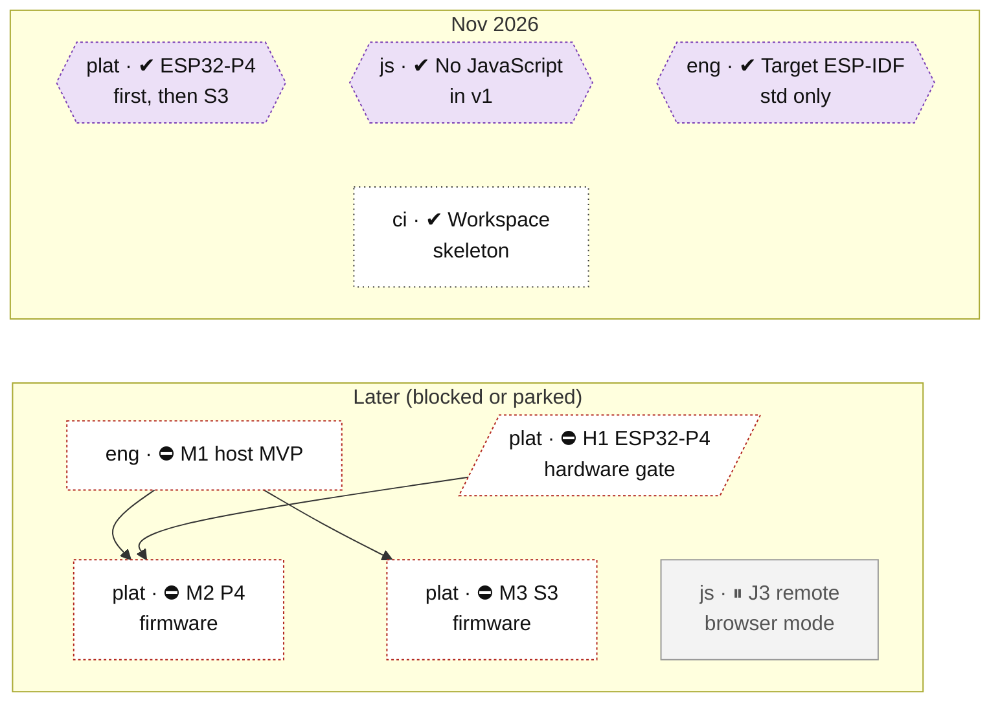

# Roadmap

Everything between the GENERATED markers is rebuilt from `roadmap/nodes.yaml`; edit that file, not the regions. Text outside the markers is kept.

## Legend

```mermaid
flowchart TB
    %% legend
    subgraph lg_g0["Done: colour is the rating"]
        direction LR
        lg_s0["✔ very successful"]
        lg_s1["✔ successful, or fixed"]
        lg_s2["✔ mixed"]
        lg_s3["✔ bad (regression)"]
        lg_s4["✔ done, not rated"]
    end
    subgraph lg_g1["Closed"]
        direction LR
        lg_s5["✖ dead end"]
        lg_s6["↷ superseded"]
    end
    subgraph lg_g2["Open: colour is the state"]
        direction LR
        lg_s7["▶ in progress"]
        lg_s8["⏳ built, waiting"]
        lg_s9["○ next"]
        lg_s10["⛔ blocked"]
        lg_s11["⏸ parked"]
        lg_s12>"⚠ open, never rated"]
    end
    subgraph lg_shape["Shape: kind"]
        direction LR
        lg_k0["○ feature"]
        lg_k1[/"○ experiment"/]
        lg_k2["○ tooling"]
        lg_k3>"⚠ defect"]
        lg_k4{{"○ owner-decision<br/>(open, not drawn)"}}
        lg_k5{{"✔ owner-decision<br/>(decided)"}}
    end
    subgraph lg_edge["Arrow (in the trees every arrow points down, forward in time)"]
        direction LR
        lg_e0a["prerequisite"]
        lg_e0b["depends on it"]
        lg_e1a["old design"]
        lg_e1b["replaced by"]
        lg_e2a["rated node"]
        lg_e2b["qualified by a later finding"]
    end
    lg_g0 ~~~ lg_g1 ~~~ lg_g2 ~~~ lg_shape ~~~ lg_edge
    lg_e0a --> lg_e0b
    lg_e1a -.-> lg_e1b
    lg_e2a -.-> lg_e2b
    linkStyle 6 stroke:#e69500,stroke-width:3px,stroke-dasharray:2 3
    classDef vsucc fill:#2e9e4f,stroke:#1b6b34,color:#fff
    classDef succ fill:#bfe8c8,stroke:#2e9e4f,color:#111
    classDef mixed fill:#ffd37a,stroke:#c98a00,color:#111
    classDef bad fill:#f28b82,stroke:#b3261e,color:#111
    classDef dead fill:#e6e6e6,stroke:#777,stroke-dasharray:5 5,color:#555
    classDef inprog fill:#a8cdf5,stroke:#1f6fc5,color:#111
    classDef next fill:#fff,stroke:#333,color:#111
    classDef blocked fill:#fff,stroke:#b3261e,stroke-dasharray:2 2,color:#111
    classDef parked fill:#f3f3f3,stroke:#999,color:#555
    classDef unrated fill:#fff,stroke:#333,stroke-dasharray:1 3,color:#111
    classDef gate fill:#d9c2f0,stroke:#7b3fb5,color:#111
    classDef decided fill:#ece0f7,stroke:#7b3fb5,stroke-dasharray:2 2,color:#111
    classDef finding fill:#ffe0b2,stroke:#d84315,stroke-width:2px,color:#111
    classDef waiting fill:#e3f2fd,stroke:#1f6fc5,stroke-dasharray:5 5,color:#111
    class lg_s0 vsucc
    class lg_s1 succ
    class lg_s2 mixed
    class lg_s3 bad
    class lg_s4 unrated
    class lg_s5,lg_s6 dead
    class lg_s7 inprog
    class lg_s8 waiting
    class lg_s9,lg_k0,lg_k1,lg_k2,lg_e0a,lg_e0b,lg_e1a,lg_e1b,lg_e2a,lg_e2b next
    class lg_s10 blocked
    class lg_s11 parked
    class lg_s12,lg_k3 finding
    class lg_k4 gate
    class lg_k5 decided
```

<!-- BEGIN GENERATED: legend -->

Owner calls are the purple shape. A decided owner call is drawn; an open one is not, and is listed under *Waiting on the owner*. The prefix on an overview box is its track. A prerequisite implied by a longer chain is not drawn; the node tables keep every edge.
<!-- END GENERATED: legend -->

## Ratings

<!-- BEGIN GENERATED: ratings -->
No node carries a rating yet.
<!-- END GENERATED: ratings -->

## Overview

<!-- BEGIN GENERATED: overview -->

<!-- END GENERATED: overview -->

## In plain words

<!-- BEGIN GENERATED: plain-words -->
| title | status | in plain words |
|---|---|---|
| Target ESP-IDF std only | ✔ done · n/a | All Servo parts need std, so the engine runs on ESP-IDF std boards only; no_std chips are out. |
| Blitz builds for ESP32 targets | ○ next | Find out whether Blitz compiles for the P4 and S3, how big the P4 image is, and whether Stylo spawns threads. |
| M0 go or no-go | ⛔ blocked | The owner decides from the host numbers whether to build on Blitz, switch to a smaller engine, or stop. |
| M1 host MVP | ⛔ blocked | The core engine and simulator render the test pages on a PC, and taps follow links. |
| M1 side-by-side review | ⛔ blocked | The owner compares our rendering with a real browser and signs off. |
| Shadow DOM in Blitz | ⏸ parked | Contribute shadow DOM support to Blitz, the path to running Home Assistant on the device. Tracked, not planned. |
| ESP32-P4 first, then S3 | ✔ done · n/a | The ESP32-P4 boards come first, then the two ESP32-S3 boards. |
| H1 ESP32-P4 hardware gate | ⛔ blocked | Once a P4 board arrives, flash the hello firmware and measure real speed. |
| H2 ESP32-S3 hardware gate | ⛔ blocked | Once an S3 board arrives, check that atomics in external memory work and repeat the speed tests. |
| M2 P4 firmware | ⛔ blocked | Browser firmware for the ESP32-P4 board with display, touch, Wi-Fi and HTTPS. |
| M3 S3 firmware | ⛔ blocked | Browser firmware for the two ESP32-S3 boards. |
| No JavaScript in v1 | ✔ done · n/a | Version 1 renders pages without running scripts; JavaScript is a parallel track. |
| J1 QuickJS on the P4 | ⏸ parked | Check that the QuickJS-ng JavaScript engine fits and runs fast enough on the P4. |
| J2 minimal DOM and web APIs | ⏸ parked | Give scripts a small DOM and the web calls small dashboards use. |
| J3 remote browser mode | ⏸ parked | Show Home Assistant by streaming a real browser running on a server. This bypasses our renderer. |
| J4 auto local or remote mode | ⏸ parked | Pick local or remote rendering for each site automatically. |
| Workspace skeleton | ✔ done · unrated | Empty Cargo workspace, ADRs 0001-0006, this roadmap and a first CI workflow. |
<!-- END GENERATED: plain-words -->

## Ready now

<!-- BEGIN GENERATED: ready-now -->
**docker**

- `eng-blitz-builds-esp`: Blitz builds for ESP32 targets
<!-- END GENERATED: ready-now -->

## Running

<!-- BEGIN GENERATED: running -->
_None._
<!-- END GENERATED: running -->

## Built, waiting

<!-- BEGIN GENERATED: built-waiting -->
_None._
<!-- END GENERATED: built-waiting -->

## Waiting on the owner

<!-- BEGIN GENERATED: waiting-on-owner -->
- `eng-m0-go-no-go`: M0 go or no-go
- `eng-m1-side-by-side-review`: M1 side-by-side review
<!-- END GENERATED: waiting-on-owner -->

## Timeline

<!-- BEGIN GENERATED: timeline -->
[The timeline](roadmap/timeline.md) shows every dated node as a bar from its start to its end.

Generated on 2026-11-27.
<!-- END GENERATED: timeline -->

## Done, by month

<!-- BEGIN GENERATED: done-by-month -->

<b>Nov 2026</b>: 11 done

- `ci-emulation-check`: Check ESP32 emulation options (✔ done · unrated). See whether the P4 boots in QEMU or Wokwi; otherwise emulate only the S3.
- `ci-workspace-skeleton`: Workspace skeleton (✔ done · unrated). Empty Cargo workspace, ADRs 0001-0006, this roadmap and a first CI workflow.
- `doc-corpus-choice`: Choose the test page corpus (✔ done · n/a). Test pages are Home Assistant-like, server-rendered sites and a simple custom dashboard.
- `doc-name-embedded-browser`: Name the project (✔ done · n/a). The owner chose the name embedded-browser.
- `doc-public-repo`: Make the repository public (✔ done · n/a). The repository is public under MIT OR Apache-2.0, so test pages must be safe to publish.
- `eng-peak-heap`: Measure peak heap by category (✔ done · unrated). Measure how much memory the engine needs for each corpus page, split by what uses it.
- `eng-raster-estimate`: Estimate raster speed (✔ done · unrated). Time the two software rasterizers on the host to guess how fast the P4 will draw.
- `eng-std-only-esp-idf`: Target ESP-IDF std only (✔ done · n/a). All Servo parts need std, so the engine runs on ESP-IDF std boards only; no_std chips are out.
- `js-host-spike`: Run corpus scripts in QuickJS (✔ done · unrated). On the host, run the small corpus scripts in QuickJS-ng to learn how much memory and which web APIs they need.
- `js-no-js-in-v1`: No JavaScript in v1 (✔ done · n/a). Version 1 renders pages without running scripts; JavaScript is a parallel track.
- `plat-boards-p4-first`: ESP32-P4 first, then S3 (✔ done · n/a). The ESP32-P4 boards come first, then the two ESP32-S3 boards.

<!-- END GENERATED: done-by-month -->

## Tracks

<!-- BEGIN GENERATED: tracks -->
Each track has its own page with its tree, node table and per-node details.

- [eng - engine](roadmap/tracks/eng.md): 8 nodes (3 done, 1 next, 3 blocked, 1 parked)
- [plat - platform](roadmap/tracks/plat.md): 5 nodes (1 done, 4 blocked)
- [js - JavaScript](roadmap/tracks/js.md): 6 nodes (2 done, 4 parked)
- [ci - build and test](roadmap/tracks/ci.md): 2 nodes (2 done)
- [doc - documentation](roadmap/tracks/doc.md): 3 nodes (3 done)
<!-- END GENERATED: tracks -->
