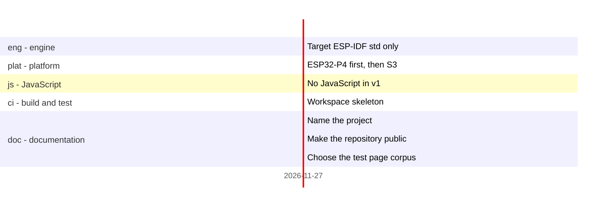

<!-- Generated by build.py from roadmap/nodes.yaml. Do not edit. -->

# Timeline

[Back to the page](../roadmap.md)

Generated on 2026-11-27. Open bars end on that date.

<!-- BEGIN GENERATED: timeline -->

Not shown (no `start`): `eng-blitz-builds-esp`, `eng-peak-heap`, `eng-raster-estimate`, `eng-m0-go-no-go`, `eng-m1-host-mvp`, `eng-m1-side-by-side-review`, `eng-shadow-dom-upstream`, `plat-h1-p4-gate`, `plat-h2-s3-gate`, `plat-m2-p4-firmware`, `plat-m3-s3-firmware`, `js-host-spike`, `js-j1-quickjs-on-p4`, `js-j2-minimal-dom-apis`, `js-j3-remote-mode`, `js-j4-auto-mode`, `ci-emulation-check`
<!-- END GENERATED: timeline -->
