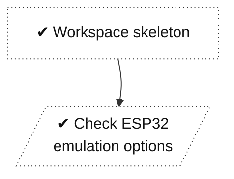

<!-- Generated by build.py from roadmap/nodes.yaml. Do not edit. -->

# ci - build and test

Scope: Docker, emulation, CI, measurement tools.

[Back to the page](../../roadmap.md) · [legend](../../roadmap.md#legend)

<!-- BEGIN GENERATED: track-ci -->

<!-- END GENERATED: track-ci -->

## Node table

<!-- BEGIN GENERATED: table-ci -->
| id | title | kind | lane | state | outcome | start | end | depends_on | replaced_by | qualified_by | headline | evidence |
|---|---|---|---|---|---|---|---|---|---|---|---|---|
| `ci-workspace-skeleton` | Workspace skeleton | tooling | host | done | unrated | 2026-11-27 | 2026-11-27 |  |  |  |  | initial commit |
| `ci-emulation-check` | Check ESP32 emulation options | experiment | docker | done | unrated | 2026-11-27 | 2026-11-27 | ci-workspace-skeleton |  |  | S3 QEMU boots with octal PSRAM and matches a golden screenshot; P4 boots a C hello world in QEMU 9.2.2 (no display); touch is not emulated in QEMU | docs/m0/emulation-results.md; scripts/qemu-s3-screenshot.sh; boards/s3-qemu-test |

### Details per node

| id | title | verdict | headline | in plain words | notes | confirmed | waiting on | queue order | order reason |
|---|---|---|---|---|---|---|---|---|---|
| `ci-workspace-skeleton` | Workspace skeleton |  |  | Empty Cargo workspace, ADRs 0001-0006, this roadmap and a first CI workflow. |  |  |  |  |  |
| `ci-emulation-check` | Check ESP32 emulation options |  | S3 QEMU boots with octal PSRAM and matches a golden screenshot; P4 boots a C hello world in QEMU 9.2.2 (no display); touch is not emulated in QEMU | See whether the P4 boots in QEMU or Wokwi; otherwise emulate only the S3. | Done when: the P4 is tried in QEMU 9.2.2 and Wokwi beta with the result recorded, and an S3 QEMU test pattern with screendump works as fallback. |  |  |  |  |
<!-- END GENERATED: table-ci -->
