<!-- Generated by build.py from roadmap/nodes.yaml. Do not edit. -->

# doc - documentation

Scope: README, ADRs, corpus policy.

[Back to the page](../../roadmap.md) · [legend](../../roadmap.md#legend)

```mermaid
flowchart TB
    doc_name_embedded_browser{{"✔ Name the project"}}
    doc_public_repo{{"✔ Make the repository<br/>public"}}
    doc_corpus_choice{{"✔ Choose the test page<br/>corpus"}}
    classDef vsucc fill:#2e9e4f,stroke:#1b6b34,color:#fff
    classDef succ fill:#bfe8c8,stroke:#2e9e4f,color:#111
    classDef mixed fill:#ffd37a,stroke:#c98a00,color:#111
    classDef bad fill:#f28b82,stroke:#b3261e,color:#111
    classDef dead fill:#e6e6e6,stroke:#777,stroke-dasharray:5 5,color:#555
    classDef inprog fill:#a8cdf5,stroke:#1f6fc5,color:#111
    classDef next fill:#fff,stroke:#333,color:#111
    classDef blocked fill:#fff,stroke:#b3261e,stroke-dasharray:2 2,color:#111
    classDef parked fill:#f3f3f3,stroke:#999,color:#555
    classDef unrated fill:#fff,stroke:#333,stroke-dasharray:1 3,color:#111
    classDef gate fill:#d9c2f0,stroke:#7b3fb5,color:#111
    classDef decided fill:#ece0f7,stroke:#7b3fb5,stroke-dasharray:2 2,color:#111
    classDef finding fill:#ffe0b2,stroke:#d84315,stroke-width:2px,color:#111
    classDef waiting fill:#e3f2fd,stroke:#1f6fc5,stroke-dasharray:5 5,color:#111
    class doc_name_embedded_browser,doc_public_repo,doc_corpus_choice decided
```

<!-- BEGIN GENERATED: track-doc -->

<!-- END GENERATED: track-doc -->

## Node table

<!-- BEGIN GENERATED: table-doc -->
| id | title | kind | lane | state | outcome | start | end | depends_on | replaced_by | qualified_by | headline | evidence |
|---|---|---|---|---|---|---|---|---|---|---|---|---|
| `doc-name-embedded-browser` | Name the project | owner-decision | owner | done | n/a | 2026-11-27 | 2026-11-27 |  |  |  |  | planning session 2026-11-27 |
| `doc-public-repo` | Make the repository public | owner-decision | owner | done | n/a | 2026-11-27 | 2026-11-27 |  |  |  |  | docs/adr/0005-licensing.md |
| `doc-corpus-choice` | Choose the test page corpus | owner-decision | owner | done | n/a | 2026-11-27 | 2026-11-27 |  |  |  |  | docs/adr/0005-licensing.md |

### Details per node

| id | title | verdict | headline | in plain words | notes | confirmed | waiting on | queue order | order reason |
|---|---|---|---|---|---|---|---|---|---|
| `doc-name-embedded-browser` | Name the project |  |  | The owner chose the name embedded-browser. |  |  |  |  |  |
| `doc-public-repo` | Make the repository public |  |  | The repository is public under MIT OR Apache-2.0, so test pages must be safe to publish. |  |  |  |  |  |
| `doc-corpus-choice` | Choose the test page corpus |  |  | Test pages are Home Assistant-like, server-rendered sites and a simple custom dashboard. |  |  |  |  |  |
<!-- END GENERATED: table-doc -->
