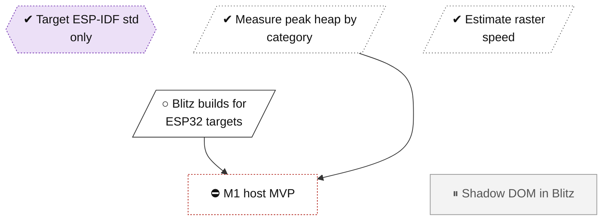

<!-- Generated by build.py from roadmap/nodes.yaml. Do not edit. -->

# eng - engine

Scope: parse, style, layout, paint, events.

[Back to the page](../../roadmap.md) · [legend](../../roadmap.md#legend)

<!-- BEGIN GENERATED: track-eng -->

<!-- END GENERATED: track-eng -->

## Node table

<!-- BEGIN GENERATED: table-eng -->
| id | title | kind | lane | state | outcome | start | end | depends_on | replaced_by | qualified_by | headline | evidence |
|---|---|---|---|---|---|---|---|---|---|---|---|---|
| `eng-std-only-esp-idf` | Target ESP-IDF std only | owner-decision | owner | done | n/a | 2026-11-27 | 2026-11-27 |  |  |  |  | docs/adr/0001-std-only-esp-idf-targets.md |
| `eng-blitz-builds-esp` | Blitz builds for ESP32 targets | experiment | docker | next | unrated |  |  | ci-workspace-skeleton |  |  |  |  |
| `eng-peak-heap` | Measure peak heap by category | experiment | host | done | unrated | 2026-11-27 | 2026-11-27 | ci-workspace-skeleton |  |  | 32-bit peak 1.1-3.6 MB on synthetic pages, 8.7 MB on a Wikipedia article (P4 go; S3 only for small pages) | docs/m0/host-results.md |
| `eng-raster-estimate` | Estimate raster speed | experiment | host | done | unrated | 2026-11-27 | 2026-11-27 | ci-workspace-skeleton |  |  | Provisional P4 full frame ~0.1-0.7 s with vello_cpu, up to 3.3 s with tiny-skia; banding works; Stylo damage is readable | docs/m0/host-results.md |
| `eng-m0-go-no-go` | M0 go or no-go | owner-decision | owner | blocked | n/a |  |  | eng-blitz-builds-esp, eng-peak-heap |  |  |  |  |
| `eng-m1-host-mvp` | M1 host MVP | feature | host | blocked | unrated |  |  | eng-m0-go-no-go |  |  |  |  |
| `eng-m1-side-by-side-review` | M1 side-by-side review | owner-decision | owner | blocked | n/a |  |  | eng-m1-host-mvp |  |  |  |  |
| `eng-shadow-dom-upstream` | Shadow DOM in Blitz | feature | host | parked | unrated |  |  |  |  |  |  |  |

### Details per node

| id | title | verdict | headline | in plain words | notes | confirmed | waiting on | queue order | order reason |
|---|---|---|---|---|---|---|---|---|---|
| `eng-std-only-esp-idf` | Target ESP-IDF std only |  |  | All Servo parts need std, so the engine runs on ESP-IDF std boards only; no_std chips are out. |  |  |  |  |  |
| `eng-blitz-builds-esp` | Blitz builds for ESP32 targets |  |  | Find out whether Blitz compiles for the P4 and S3, how big the P4 image is, and whether Stylo spawns threads. | Done when: hello-Blitz compiles for the P4 (and S3, compile-only), 64-bit atomics availability is recorded, sequential Stylo is confirmed thread-free, the P4 image size is recorded against the go (<=8MB), fallback (8-14MB) and stop (>14MB) thresholds, and a hello firmware that prints timings over serial is ready for H1. |  |  |  |  |
| `eng-peak-heap` | Measure peak heap by category |  | 32-bit peak 1.1-3.6 MB on synthetic pages, 8.7 MB on a Wikipedia article (P4 go; S3 only for small pages) | Measure how much memory the engine needs for each corpus page, split by what uses it. | Done when: peak heap on a 32-bit host (i686 or wasm32) is recorded per category (DOM/style/layout, text/glyphs, images, net) for the corpus, against go (<=12MB), fallback (12-20MB) and stop (>20MB); the S3 8MB tier needs <=4MB. Home Assistant is a static HA-like page or post-script DOM snapshot. Result: wasm32-wasip1 (i686-msvc fails an anyrender size assert), engine + 32px vello_cpu bands: dashboard 1.10, article 3.58, links 1.72, HN 2.13, Wikipedia 8.65 MB; a full RGBA frame adds ~3.2 MB. Sequential styling spawns no threads. |  |  |  |  |
| `eng-raster-estimate` | Estimate raster speed |  | Provisional P4 full frame ~0.1-0.7 s with vello_cpu, up to 3.3 s with tiny-skia; banding works; Stylo damage is readable | Time the two software rasterizers on the host to guess how fast the P4 will draw. | Done when: vello_cpu and tiny-skia are timed with scalar code paths and the size-build profile, derated by a CoreMark ratio as a provisional estimate; banded paint_scene is verified and any damage source in Blitz is identified. Result: scalar via wasm32 (no simd128) x5.4 CoreMark derate (P4 single core assumed 1245 at 360 MHz), PSRAM penalty not modelled. Banding via viewport scroll matches the full frame (vello_cpu <=3 px). RestyleDamage readable between resolve_stylist and resolve; highlight re-raster estimate ~0.33 s. |  |  |  |  |
| `eng-m0-go-no-go` | M0 go or no-go |  |  | The owner decides from the host numbers whether to build on Blitz, switch to a smaller engine, or stop. | Done when: the owner has read the M0 numbers (build, image size, peak heap) and chosen go, fallback or stop. Go means M1 starts; fallback or stop always comes back to the owner. |  |  |  |  |
| `eng-m1-host-mvp` | M1 host MVP |  |  | The core engine and simulator render the test pages on a PC, and taps follow links. | Done when: the core and simulator render the corpus, taps navigate, the capped-heap test passes, and each page has a reference screenshot from a real browser at the same viewport with JS off. |  |  |  |  |
| `eng-m1-side-by-side-review` | M1 side-by-side review |  |  | The owner compares our rendering with a real browser and signs off. | Done when: the owner has reviewed engine and reference screenshots side by side and signed off; the goldens are then frozen for regression. |  |  |  |  |
| `eng-shadow-dom-upstream` | Shadow DOM in Blitz |  |  | Contribute shadow DOM support to Blitz, the path to running Home Assistant on the device. Tracked, not planned. | Done when: Blitz upstream supports shadow DOM and custom elements well enough for Home Assistant's frontend. |  |  |  |  |
<!-- END GENERATED: table-eng -->
