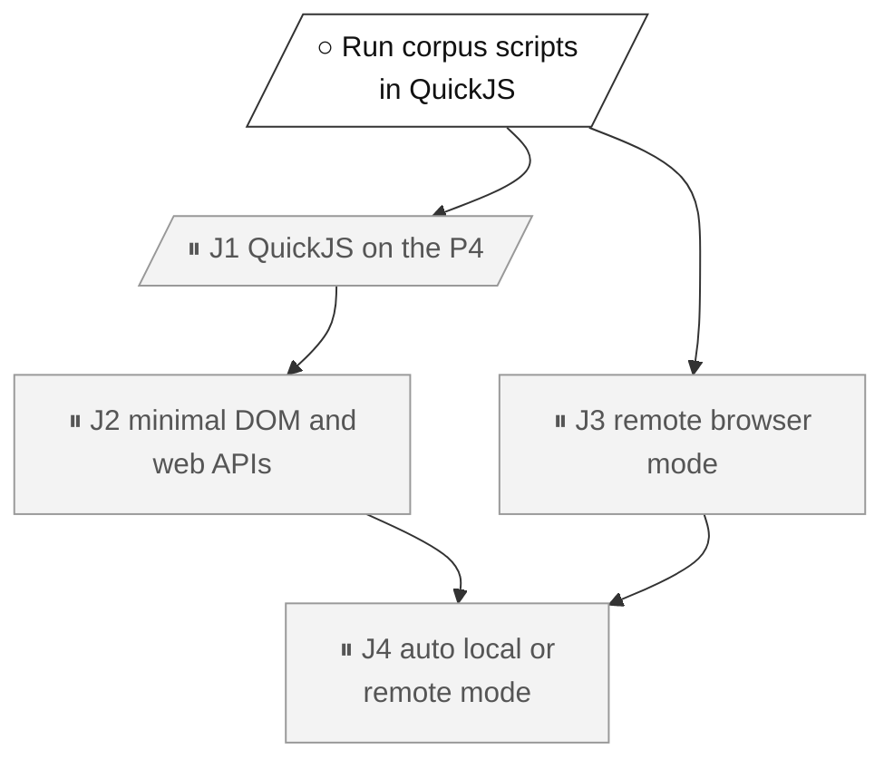

<!-- Generated by build.py from roadmap/nodes.yaml. Do not edit. -->

# js - JavaScript

Scope: on-device JS and remote mode.

[Back to the page](../../roadmap.md) · [legend](../../roadmap.md#legend)

<!-- BEGIN GENERATED: track-js -->

<!-- END GENERATED: track-js -->

## Node table

<!-- BEGIN GENERATED: table-js -->
| id | title | kind | lane | state | outcome | start | end | depends_on | replaced_by | qualified_by | headline | evidence |
|---|---|---|---|---|---|---|---|---|---|---|---|---|
| `js-no-js-in-v1` | No JavaScript in v1 | owner-decision | owner | done | n/a | 2026-11-27 | 2026-11-27 |  |  |  |  | docs/adr/0004-js-hybrid-strategy.md |
| `js-host-spike` | Run corpus scripts in QuickJS | experiment | host | next | unrated |  |  | ci-workspace-skeleton |  |  |  |  |
| `js-j1-quickjs-on-p4` | J1 QuickJS on the P4 | experiment | hardware | parked | unrated |  |  | js-host-spike, plat-h1-p4-gate |  |  |  |  |
| `js-j2-minimal-dom-apis` | J2 minimal DOM and web APIs | feature | host | parked | unrated |  |  | js-j1-quickjs-on-p4 |  |  |  |  |
| `js-j3-remote-mode` | J3 remote browser mode | feature | docker | parked | unrated |  |  | js-host-spike |  |  |  |  |
| `js-j4-auto-mode` | J4 auto local or remote mode | feature | host | parked | unrated |  |  | js-j2-minimal-dom-apis, js-j3-remote-mode |  |  |  |  |

### Details per node

| id | title | verdict | headline | in plain words | notes | confirmed | waiting on | queue order | order reason |
|---|---|---|---|---|---|---|---|---|---|
| `js-no-js-in-v1` | No JavaScript in v1 |  |  | Version 1 renders pages without running scripts; JavaScript is a parallel track. |  |  |  |  |  |
| `js-host-spike` | Run corpus scripts in QuickJS |  |  | On the host, run the small corpus scripts in QuickJS-ng to learn how much memory and which web APIs they need. | Done when: the custom dashboard, Tasmota, ESPHome v1 and htmx scripts run under a memory cap with a logging stub DOM, with peak heap, parse time and the list of web APIs touched recorded. The Home Assistant bundle is measured for information only. |  |  |  |  |
| `js-j1-quickjs-on-p4` | J1 QuickJS on the P4 |  |  | Check that the QuickJS-ng JavaScript engine fits and runs fast enough on the P4. | Done when: QuickJS-ng runs on the P4 via rquickjs (fallback: Espressif component via bindgen) with flash cost <=1.5MB, idle RAM <=1MB, and a 100KB script parsed in <=300ms. |  |  |  |  |
| `js-j2-minimal-dom-apis` | J2 minimal DOM and web APIs |  |  | Give scripts a small DOM and the web calls small dashboards use. | Done when: querySelector, attributes, text, classList, style, events, timers, fetch/XHR, WebSocket and EventSource work, unsupported APIs are stubbed and logged, the custom dashboard, Tasmota, ESPHome v1 and htmx pages work, touch-to-pixel p95 is <=100ms and a 24h soak passes. |  |  |  |  |
| `js-j3-remote-mode` | J3 remote browser mode |  |  | Show Home Assistant by streaming a real browser running on a server. This bypasses our renderer. | Done when: a VNC-style client and a companion container (Chromium kiosk, Xvfb, x11vnc, usable as an HA add-on) show HA Lovelace and Grafana with touch-to-visible p95 <=150ms. |  |  |  |  |
| `js-j4-auto-mode` | J4 auto local or remote mode |  |  | Pick local or remote rendering for each site automatically. | Done when: each origin is routed to local or remote mode based on detected customElements, attachShadow or canvas use. |  |  |  |  |
<!-- END GENERATED: table-js -->
