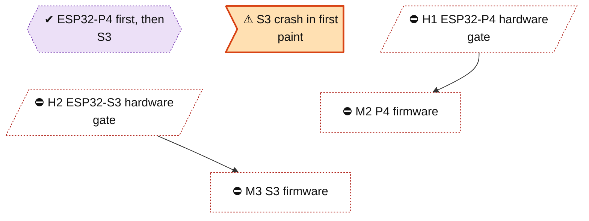

<!-- Generated by build.py from roadmap/nodes.yaml. Do not edit. -->

# plat - platform

Scope: ESP adapters and board firmware.

[Back to the page](../../roadmap.md) · [legend](../../roadmap.md#legend)

<!-- BEGIN GENERATED: track-plat -->

<!-- END GENERATED: track-plat -->

## Node table

<!-- BEGIN GENERATED: table-plat -->
| id | title | kind | lane | state | outcome | start | end | depends_on | replaced_by | qualified_by | headline | evidence |
|---|---|---|---|---|---|---|---|---|---|---|---|---|
| `plat-boards-p4-first` | ESP32-P4 first, then S3 | owner-decision | owner | done | n/a | 2026-11-27 | 2026-11-27 |  |  |  |  | planning session 2026-11-27 |
| `plat-h1-p4-gate` | H1 ESP32-P4 hardware gate | experiment | hardware | blocked | unrated |  |  | eng-blitz-builds-esp |  |  |  |  |
| `plat-h2-s3-gate` | H2 ESP32-S3 hardware gate | experiment | hardware | blocked | unrated |  |  | eng-blitz-builds-esp |  |  |  |  |
| `plat-m2-p4-firmware` | M2 P4 firmware | feature | hardware | blocked | unrated |  |  | plat-h1-p4-gate, eng-m1-side-by-side-review, eng-m1-touch-events-forms, eng-m1-scroll-strip-cache |  |  |  |  |
| `plat-m3-s3-firmware` | M3 S3 firmware | feature | hardware | blocked | unrated |  |  | plat-h2-s3-gate, eng-m1-side-by-side-review, eng-m1-touch-events-forms, eng-m1-scroll-strip-cache |  |  |  |  |
| `plat-defect-s3-paint-crash` | S3 crash in first paint | defect | docker | next | unrated | 2026-11-27 |  | eng-blitz-builds-esp |  |  |  | docs/m0/emulation-results.md |

### Details per node

| id | title | verdict | headline | in plain words | notes | confirmed | waiting on | queue order | order reason |
|---|---|---|---|---|---|---|---|---|---|
| `plat-boards-p4-first` | ESP32-P4 first, then S3 |  |  | The ESP32-P4 boards come first, then the two ESP32-S3 boards. |  |  |  |  |  |
| `plat-h1-p4-gate` | H1 ESP32-P4 hardware gate |  |  | Once a P4 board arrives, flash the hello firmware and measure real speed. | Done when: on a P4 the full frame is <=1s (fallback 1-3s, stop >3s), damage-limited highlight re-raster <=100ms (fallback <=300ms), drag scroll from the strip cache >=20fps (fallback >=10fps), and PSRAM atomics with Stylo work. Raster fallback is the other rasterizer, then simplified paint. Run by the owner. |  |  |  |  |
| `plat-h2-s3-gate` | H2 ESP32-S3 hardware gate |  |  | Once an S3 board arrives, check that atomics in external memory work and repeat the speed tests. | Done when: a tiny firmware exercising Arc and atomics in PSRAM passes on an S3, and the H1 metrics are measured at 800x480. Run by the owner. |  |  |  |  |
| `plat-m2-p4-firmware` | M2 P4 firmware |  |  | Browser firmware for the ESP32-P4 board with display, touch, Wi-Fi and HTTPS. | Done when: Wikipedia renders on the P4 hardware and scrolls by touch (DSI, GT911, Wi-Fi via esp-hosted on the C6, HTTPS). |  |  |  |  |
| `plat-m3-s3-firmware` | M3 S3 firmware |  |  | Browser firmware for the two ESP32-S3 boards. | Done when: pages render and scroll by touch on the S3-BOX-3 (SPI) and then the 7-inch RGB board. If H2 fails on atomics, the S3 uses a software-atomics target spec (any Rust Arc or Mutex in PSRAM is affected, whatever the engine). |  |  |  |  |
| `plat-defect-s3-paint-crash` | S3 crash in first paint |  |  | On the emulated S3, hello-Blitz parses, styles and lays out the page, then crashes in vello_cpu's alpha compositing on the first paint. | Done when: the cause (QEMU artefact or real Xtensa bug) is known with evidence, and fixed or worked around so the S3 QEMU hello-Blitz run prints its paint phase. |  |  |  |  |
<!-- END GENERATED: table-plat -->
